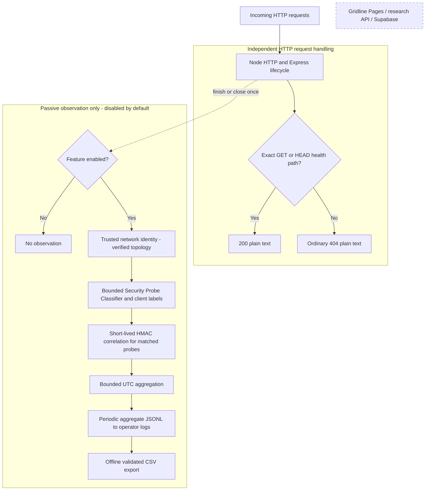

# Passive Security Probe Sensor

**Experimental, observation-only; disabled by default.** [繁體中文](README.zh-TW.md)

Independent Node.js/Express HTTP listener for defensive detection engineering and learning. It observes only HTTP requests that reach this sensor, not Gridline GitHub Pages, Gridline's loopback research API, Supabase, or other infrastructure. No honeypot files, fake credentials, active scanning, blocking by classification, retaliation, or deception. No production activation is implied by a PR or merge.

## Architecture



The HTTP path never depends on the observer's decision. The only successful public application route is an exact GET/HEAD `/health` (query ignored). Phase 3 counts successful health-route responses separately from non-health requests; this does not identify the caller as a trusted monitor. Other paths, including probes, receive ordinary text/plain 404. No general static file serving, body parser, business credentials, proxying or research imports. Phase 2 adds only exact, authenticated operator routes; see the dashboard section. A generic error handler avoids reflecting request details. Observation runs once at response finish or records an aborted count at close; it never changes the status. Parser-level rejection, CONNECT/upgrade, upstream rejection and traffic not delivered to Express are outside completed HTTP coverage. Transport timeouts and capacity safeguards apply equally whether observation is on or off.

BoxMatch's [Request Intelligence](https://github.com/LEO0331/boxmatch/blob/main/docs/REQUEST_INTELLIGENCE.md) inspired bounded extraction, conservative source confidence, HMAC and failure isolation. This service deliberately does not copy its per-request logs, risk scores, DNS verification, databases or dashboards.

## Local development and tests

Node 22 or later; use the separate package and lockfile. No root install is necessary.

```sh
cd security-probe-sensor
npm ci --ignore-scripts
npm test
npm audit --omit=dev --audit-level=low
npm start
```

The listener defaults to 127.0.0.1:8080 and does not collect anything. To run an opt-in local synthetic experiment, stop it and use:

```sh
ENABLE_PASSIVE_PROBE_SENSOR=true npm start
# In another terminal, only the local sensor:
curl -i http://127.0.0.1:8080/health
curl -i http://127.0.0.1:8080/.env
```

Local loopback identity is intentionally unresolved. Wait for a periodic report or stop with SIGINT to emit the final aggregate. Do not send these fixtures to third-party services. CI uses the pinned isolated npm lockfile, Node 22, syntax checks, synthetic fixtures and local HTTP, plus a blocking npm advisory audit (all severities). The npm install/audit contacts the package registry, not scanner targets.

## Independent deployment boundary

Build only this directory as Docker context. A Render blueprint is supplied in the repository root; provisioning and runtime activation are operator-managed. Keep the research API local; never route sensor requests to the existing API or public site. Start disabled, with an independent service identity, no Gridline environment variables/volume mounts, no outbound access except infrastructure needs, read-only filesystem, non-root user, CPU/memory/PID quotas and operator-only logs. Example local-only container:

```sh
docker build -t gridline-probe-sensor .
docker run --rm --read-only --cap-drop=ALL --security-opt=no-new-privileges \
  --memory=128m --cpus=0.5 --pids-limit=64 -p 127.0.0.1:8080:8080 gridline-probe-sensor
```

Only after owner approval, choose a separate public HTTPS endpoint and ingress, confirm provider terms permit passive traffic observation, verify topology and logging defaults, then enable observation. Do not attach databases or privileged credentials. Use standard infrastructure resource limits, not probe-specific enforcement. Container port 8080 is configurable; if changed adjust port mapping. A provider's ephemeral disk is not durable: the sensor writes no files; stdout log retention/export is controlled by the host. Restart, scale-to-zero and crashes may lose unflushed windows. The Docker base tag is mutable; review/pin image digest and scan image before public rollout.

## Configuration

| Variable | Default | Purpose |
| --- | --- | --- |
| ENABLE_PASSIVE_PROBE_SENSOR | false | Only exact `true` enables observation and timers |
| SENSOR_HOST | 127.0.0.1 (container 0.0.0.0) | Listener bind address |
| SENSOR_PORT | 8080 | Integer 1–65535 |
| SENSOR_NETWORK_MODE | unresolved | `direct` or `single_proxy`, only with verified topology |
| SENSOR_TOPOLOGY_VERIFIED | false/unset | Explicit operator assertion after verification, not a proof from code |
| SENSOR_TRUSTED_PROXY_IPS | unset | At most 16 comma-separated exact canonical peer IPs; no CIDR or wildcard |
| SENSOR_HMAC_SECRET | unset | Dedicated random secret, 32–4096 UTF-8 bytes; no secret means no correlation |

Generate a unique secret locally (`node -e "console.log(require('node:crypto').randomBytes(32).toString('hex'))"`), store in the sensor host's secret manager, never commit or reuse a Gridline/BoxMatch secret. Restart to rotate; no cross-process linkage is attempted.

### Network identity preflight (mandatory before correlation)

Default `unresolved` mode ignores forwarded addresses entirely. `direct` requires a genuine direct public socket peer and no forwarding headers. `single_proxy` requires a known exact peer, ingress restricted to that proxy, and a proxy that **overwrites** X-Forwarded-For with exactly one valid public address; no comma chains, duplicate headers, arbitrary alternate headers, or client-provided source trust. Express trust proxy remains false. Normalize IPv4-mapped IPv6 and reject private/reserved addresses conservatively. Unresolved identity never generates a fingerprint.

Before setting verified=true, inspect the actual deployment network, confirm there is exactly one trusted proxy (or no proxy), confirm direct bypass is impossible and that client-supplied forwarding headers are stripped/overwritten. Use controlled local/staging fixtures under your authority to check spoofed headers, duplicate headers, missing headers, private and mapped addresses. If the provider has a variable/multi-hop proxy chain or cannot guarantee overwrite, leave unresolved. No live proxy topology has been verified by this implementation. Confidence refers to network provenance, not a person, bot identity or attacker.

## Classifier and resource limits

| Item | Fixed limit / behavior |
| --- | --- |
| Path | 4096 characters before literal query delimiter; at most two URI decodes; malformed/oversized separately counted |
| Categories | traversal, environment, git, wordpress, backup, configuration, database_dump, administration, credential; first match in fixed priority |
| User-Agent | 1024 characters, allowlisted coarse client labels and bot claims only |
| Identity window | 5 minutes from first matched probe; expired entries cleared on observation and every 30 seconds; at most 4096 HMAC keys and 9 categories per entry |
| Capacity | No new identity when full; aggregate saturation count; existing tracked identities unaffected |
| Reporting | Every 5 minutes plus graceful shutdown; at most 100,000 completed observations/window, additional completions counted as dropped; 4 UTC hour buckets, overflow explicitly counted |
| HTTP | 8 KiB headers/request line limit, 256 connections, 100 requests/socket, 10 s header timeout, 15 s request/idle timeout, 5 s keep-alive |
| Logging | One aggregate line per interval; no per-request logging; skip windows on stdout backpressure, count skips on next successful write |
| CSV | Local regular JSONL file <=10 MiB, lines <=64 KiB, fixed columns, validated keys/times/counts only |

One path receives one category; not exhaustive. Filenames/extensions may be legitimate, double-encoding support is bounded, encoded/ambiguous paths can evade recognition. No body inspection. Bot names are claims. Phase 3 optionally matches trusted sources against a local, dated prefix dataset; without it verification stays unverified and country/ASN stay unknown. No remote DNS or provider calls. No IP or fingerprint exports.

## Reporting and interpretation

JSONL event `security_probe.aggregate.v1` includes UTC windowStart/windowEnd, observed completed HTTP responses, matched probes, suspectedScanner, unexpectedSuccess (matched 2xx), repeated, multiCategory, correlationTracked/Unavailable/Saturated, aborted, dropped, observationErrors, and hourOverflow. Distributions cover categories, methods, actual status, client, claimedBots, verification, identity, pathResults, countries, asns, and UTC hours/days (observed/matched counts). Each repeated count means a matched request following an earlier matched request on the same tracked network within its fixed window; multiCategory counts matched requests where the tracked window has seen at least two categories. These are request counts, not unique networks or people. Shared networks, NAT, VPN and proxy configuration can produce false positives. A full identity table or missing secret causes undercounting; use coverage counters.

Interpret a matched probe as an **observation**, a path or scanner UA heuristic as a **suspected scanner**, and a matched 2xx as an **investigation signal** only. This sensor cannot establish a confirmed incident, compromise, person or intent. The fixed 404 responses do not reveal whether a real Gridline resource exists.

An emitted interval with observed=0 means zero recorded completed observations in that interval (see dropped/errors/aborted). Absent interval, disabled flag, process downtime, dropped logs or unobserved upstream requests mean missing coverage, not zero traffic. Hour/day rows are sparse; sum across non-overlapping recorded intervals with coverage checks and do not fill absent intervals as zero. Multiple replicas report independently; do not treat their repeat counts as global. No event-level UTC timestamps retained. Use actual window bounds, not an assumed exact five-minute duration.

Download only operator-authorized aggregate application logs as JSONL (strip provider prefixes locally if necessary). Export offline:

```sh
npm run --silent csv -- aggregate.jsonl > aggregate.csv
```

CSV rows contain window_start_utc, window_end_utc, dimension, key, count. Unknown strings and formula payloads are not exported. Nonmatching or malformed lines are skipped; compare report counts to source logs before using the CSV. Daily/hourly rows are per-window contributions, not cumulative totals. The offline exporter does not merge windows or authorize remote access; keep logs and CSV private. Phase 2 provides a separately authenticated aggregate export.

## Privacy, operations and rollback

Raw addresses, request targets, query values, headers, bodies, cookies and tokens are not logged or persisted by the sensor. Raw path and UA are inspected transiently. HMAC keys live only in process memory and are not included in reports. Do not enable core dumps, request tracing or platform access logs that collect sensitive request data without separate review; upstream proxy/hosting logs are outside this application's control. Restrict report access, avoid public datasets, and choose a short aggregate retention period (suggested 7–30 days subject to policy).

Before rollout: verify CI/audit, container supply chain, host limits, network topology, no raw access logging, and operator log export. Enable collection only on the separate sensor; verify local/staging 404/health, observed zero/missing coverage and privacy. If errors or resource pressure occur set ENABLE_PASSIVE_PROBE_SENSOR=false and restart, or stop/delete the independent service and ingress. Discard/expire operator logs per policy. No Gridline data migration or rollback is required. Do not merge or activate without owner approval.

Verification status: source-level implementation and synthetic test suite; see the PR checks for actual executed results. No live traffic experiment or production deployment is part of this change.

## Phase 2 — operator dashboard and Render deployment

The operator dashboard uses plain HTML, CSS and JavaScript, no additional dependencies, no public dashboard on GitHub Pages, no database and no storage of individual network identities. Both observation and dashboard flags default to false. Phase 3 adds separate, default-disabled enrichment flags. The dashboard is optional and independent of observation; a dashboard with observation disabled shows missing coverage.

### View locally

With Node 22+ installed, use a dedicated cryptographically random password (32–256 printable non-space ASCII characters). For PowerShell, from the sensor directory:

```powershell
npm ci --ignore-scripts
$env:ENABLE_SENSOR_DASHBOARD = 'true'
$env:SENSOR_OPERATOR_PASSWORD = (node -e "console.log(require('node:crypto').randomBytes(32).toString('hex'))")
$env:ENABLE_PASSIVE_PROBE_SENSOR = 'true' # optional, local synthetic observation only
npm start
```

Open http://127.0.0.1:8080/operator and enter username `operator` and your generated password (retrieve it from your local environment in a private terminal). Never put the password in a URL, commit, screenshot or logs. Use localhost HTTP only for development; use HTTPS for remote access. The initial dashboard displays no recorded windows until the first periodic flush (approximately five minutes); Refresh reloads completed windows, not the current partial interval.

### Dashboard routes and authorization

| Exact GET/HEAD route | Purpose |
| --- | --- |
| `/operator` | Operator HTML, browser Basic authentication |
| `/operator/app.js`, `/operator/style.css` | Protected local assets |
| `/operator/metrics?from=YYYY-MM-DD&to=YYYY-MM-DD` | Aggregated selected windows |
| `/operator/export.csv?from=YYYY-MM-DD&to=YYYY-MM-DD` | Sanitized per-window CSV download |

Missing/invalid dashboard password or disabled flag yields normal 404s. Enabled routes require a high-entropy separate password; invalid credentials receive 401. Hash comparison uses a constant-length digest and timing-safe comparison. Cross-site browser API, asset and import requests declaring Sec-Fetch-Site: cross-site receive 403; ordinary top-level GET navigation to the protected dashboard is permitted but still authenticated; same-origin policy, no CORS, no-store, frame denial and strict CSP apply. No JS storage, query-string credentials, session database or external script. Phase 3 adds one bounded, authenticated historical aggregate import action. Only successfully authenticated exact operator requests are excluded from observation (including authorized input errors); denied requests retain actual response statuses. Concurrent reporting responses are capped at two, with operator-only 503 on saturation. Basic authentication can remain cached by the browser; use a private browser session and close it after use. Rotate the password and restart to revoke access. No custom logout/session mechanism, no MFA or per-user accounts; this is a single-operator tool, not a multi-user admin platform.

### History and coverage

History retains sanitized aggregate windows in memory only: maximum 7 days, 2,016 windows and 4 MiB of serialized CSV rows (whichever limit is hit first). Actual memory overhead is higher; no file/database storage. History can be populated whenever observation is enabled, even if dashboard is disabled; a restart clears it. Eviction and rejected-window counts are shown. The current window is excluded until flush; Phase 3 can restore previous-process aggregates through the authenticated dashboard. selected dates are UTC and limited to today and six previous UTC days. Whole windows are assigned by their start date; a window crossing midnight may show contributions on the following UTC day. Hour/day tables use actual contributions and recorded interval duration, not a claim of complete upstream coverage. Missing intervals are shown as missing, not zero; dropped/error/overflow counts qualify recorded values. No reconstruction across restarts or replicas. CSV download contains selected per-window rows; preserve existing offline log export for longer history.

### Manual Render deployment (after PR review and owner approval)

1. In Render, create a new Blueprint and connect this repository, select main and the root render.yaml. Review the proposed **single free Docker web service**; no database or paid resource is requested. Verify the free plan is available and acceptable before confirming.
2. The blueprint sets rootDir to security-probe-sensor, Docker context and Dockerfile within that directory, health check /health and port 8080. Auto-deploy is controlled in the Render service Settings (On Commit, After CI Checks Pass, or Off); the YAML omits autoDeployTrigger to preserve existing choices. New services default to On Commit. Independent operator and HMAC secrets are generated only when missing. On initial creation explicitly enter false for both feature flags and topology verification, unresolved for network mode, and leave trusted proxy IPs empty (or omit them if allowed). Missing values fail closed in code. No existing Gridline service should be linked or modified.
3. Once the service exists, retrieve its actual HTTPS URL and confirm /health returns 200 and /operator returns 404 while disabled. Do not guess the onrender.com hostname. Verify upstream logs do not retain unwanted raw request data and review the provider's acceptable-use policy.
4. In the service's Environment settings, set ENABLE_SENSOR_DASHBOARD=true and ensure SENSOR_OPERATOR_PASSWORD is a strong generated value. Apply/redeploy manually. Open the actual HTTPS service URL followed by /operator, authenticate as operator. Keep observation disabled until approved; then set ENABLE_PASSIVE_PROBE_SENSOR=true and manually redeploy.
5. Keep SENSOR_NETWORK_MODE=unresolved and SENSOR_TOPOLOGY_VERIFIED=false until the real proxy chain is verified. Render can have a topology incompatible with the sensor's single-proxy assumption; do not invent trusted proxy addresses or enable unrestricted proxy trust. Country/ASN and bot verification remain unavailable until optional local data is explicitly configured.

Render's free service can sleep, restart, and have ephemeral storage; its health and retention are not guaranteed. No persistent disk is requested. Logs are provider-managed; download authorized aggregate JSONL when needed. A sleep/redeploy may erase all dashboard history. Operational flags and network settings use sync: false, so subsequent Blueprint syncs do not overwrite existing Render values. For an existing service, set missing variables manually in Environment; a normal deployment does not reset them. The auto-deploy preference is also operator-owned. Fixed infrastructure settings are still managed by the Blueprint. Runtime configuration survives deployments; in-memory observation history does not. For reference see [Render Blueprint specification](https://render.com/docs/blueprint-spec) and [free service limitations](https://render.com/docs/free).

Rollback: set both feature flags false and redeploy, rotate the operator password if exposed, or suspend/remove only the independent sensor and its ingress. Do not expose or modify Gridline's research API. No production deployment or live observation is performed by the PR.

## Phase 3 — intelligence quality and operational reliability

Phase 3 adds measurement improvements and a bounded recovery workflow, not an enforcement engine. Existing Render-owned flags and credentials are preserved; the optional new enrichment flags and file setting also use `sync: false`. No new runtime npm dependencies or infrastructure.

### Coverage and probe interpretation

- Successful GET/HEAD `/health` responses are counted as `healthChecks` and excluded from `observed`, method/status and probe distributions. A failed health response or other HTTP method is still ordinary observed traffic. A health-route request is not necessarily a legitimate monitoring request. Previously exported Phase 1/2 windows included health checks in observed totals; they are labeled legacy and cannot be retroactively separated. Mixed-definition totals must not be used for before/after rate comparison.
- The dashboard reports process start/uptime, selected elapsed minutes, recorded interval minutes, missing selected minutes, restored/legacy/delayed windows and dropped/aborted/errors. Recorded duration is not independently verified platform uptime. The current partial interval, missing intervals, host downtime and dropped output are not zero traffic. Windows longer than six minutes are marked limited; timestamps follow UTC wall clock and window-start date attribution remains unchanged.
- Multi-category activity is grouped by the current matched category once the short-lived network window has seen at least two categories. It is not a sequence log, unique source count or attribution. Investigation indicators include unexpected matched 2xx, multi-category activity, limited coverage and a descriptive high-probe-share threshold (at least 20 recorded requests, >=50% matched). No baselines, probabilities or automatic security actions are implied.
- Dashboard auto-refresh is opt-in (60 seconds, only while visible); off by default so a passive dashboard does not intentionally keep the free instance awake. Cross-site top-level GET navigation to /operator is allowed with authentication; API/assets/import remain protected.

### Restore after a restart

Export CSV before a planned restart or download aggregate JSONL application logs through the operator's authorized log interface (strip host prefixes and retain only `security_probe.aggregate.v1` records). In /operator choose the file and click Restore. Both Phase 1/2 and Phase 3 exports are supported. Do not upload raw access logs, secrets or untrusted files. Import is authenticated, same-origin for browsers, requires a dedicated non-simple header, has no CORS, and accepts one request at a time, up to 1 MiB, 512 windows and 10 seconds of body receipt. CSV rows are checked against the canonical schema; JSONL is sanitized to the same schema. Invalid or inconsistent windows reject the import, while overlap, duplicate, age and capacity conflicts are skipped. Import counts are bounded; the same seven-day / 2,016-window / 4 MiB history limits apply. Only windows ending before or at current process start can be restored, preventing overlap with the live partial interval. Multiple instances must not be combined; use only your own authentic single-instance export. Imported reports are not cryptographically signed and cannot prove historical traffic. Restored history remains volatile; no public write endpoint, persistence, or upload to a third-party service.

### Network topology and local enrichment

Do not set `SENSOR_TOPOLOGY_VERIFIED=true` just because the dashboard displays unresolved sources. The diagnostic field `topologyAsserted` reports operator configuration, not proof. Inspect actual hosting ingress topology and confirm exact proxy socket peers, ingress restrictions, and overwrite of X-Forwarded-For with a single valid public client IP. Use an owned staging/local fixture to test direct, trusted, spoofed, duplicate, malformed and private addresses. Never infer proxy IPs from request headers. If Render's proxy cannot meet the single-proxy requirement, retain unresolved; HMAC and enrichment stay unavailable. No production proxy validation was performed in this PR.

| Operator-owned setting | Default | Meaning |
| --- | --- | --- |
| ENABLE_SENSOR_GEO_ENRICHMENT | false | Enable local country/ASN lookup |
| ENABLE_SENSOR_BOT_VERIFICATION | false | Enable local bot range matching |
| SENSOR_NETWORK_DATA_FILE | unset | Path to an operator-provided local JSON file |

Optional data is loaded once at process start, max 1 MiB, 4,096 total canonical prefixes, schema version 1 and UTC generatedAt no older than 30 days. A stale dataset also stops matching at runtime. It supports IPv4 and IPv6 longest-prefix matching, uppercase two-letter country codes and numeric ASNs (`AS123`). At most 64 country and 128 ASN labels per observation window plus unknown/other. Use an independently licensed, reviewed local source and official bot range data; no global coverage is assumed. For bots, a positive range match is `range_match`, absence remains `unverified` (not a mismatch or confirmation of a bot). Do not treat range membership as identity or intent. The service never fetches remote IP databases or DNS, and no raw client IP/prefix/fingerprint is exported. Local source data can be incomplete, stale, geographically imprecise or incorrect. The bundled service does not ship a dataset.

Example format below is **synthetic schema only**; do not deploy these mappings as factual network data:

```json
{
  "version": 1,
  "generatedAt": "2026-01-01T00:00:00.000Z",
  "geo": [{"cidr":"192.0.2.0/24","country":"TW","asn":"AS64500"}],
  "bots": [{"cidr":"198.51.100.0/24","bot":"googlebot"}]
}
```

Documentation ranges in the example are not eligible public source identities. In production, generate the file offline using reviewed data with current timestamp; use a private local file or a provider-supported secret file mount (verify plan and path, e.g. /etc/secrets/sensor-network.json), then set the path and optional flags in Render. Do not commit IP range datasets, credentials, or real exported reports. To replace stale data, update the local file and restart. No additional paid services are required; without a valid dataset and verified topology unknown is the correct result.

Startup emits a single fixed `security_probe.startup.v1` diagnostic event with enabled/configuration states, process time and password validity, never the password, HMAC, proxy addresses or file path. The dashboard exposes equivalent nonsecret observation diagnostics. The service continues serving ordinary HTTP responses when observation or enrichment is unavailable.

Rollback: disable optional enrichment flags and auto-refresh; stop importing reports. Disable observation/dashboard using Render-owned flags if needed, or revert this PR; no database migration or public-site change. The revised health-count definition is not backward-comparable without qualification. No production deployment, live network validation or external scanning is part of this PR.
