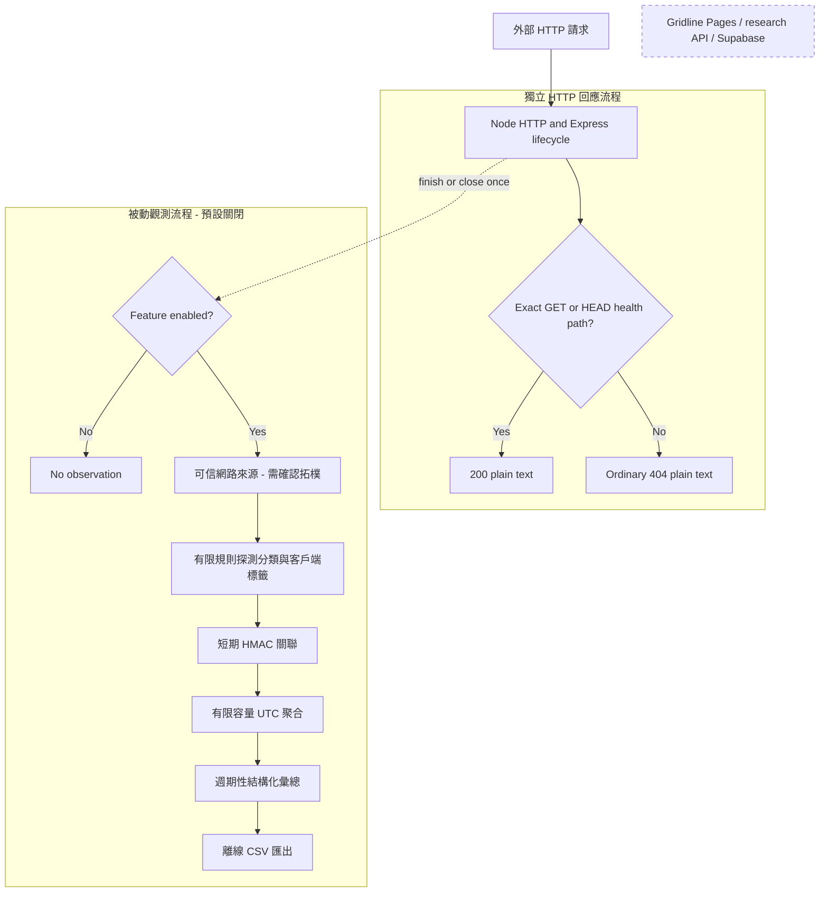

# 被動式安全探測感測器（Passive Security Probe Sensor）

[English](README.md)｜預設關閉、僅觀測、獨立部署。

本服務是 Gridline 相關的資安學習實驗，並非 Gridline 研究系統的資安監控平台。只觀測抵達感測器 HTTP 端點的請求，不代表 GitHub Pages、研究 API 或 Supabase 遭受掃描。不建立假憑證、敏感文件、誘導頁面或主動封鎖機制。

## 架構

HTTP 回應與觀測分離：GET/HEAD /health 回傳 200，其餘未知路徑正常回傳 404。僅在 HTTP 完成時記錄實際狀態碼；中斷請求另計，不以虛構狀態碼代替。觀測錯誤不影響 HTTP 回應。無研究資料、帳號、投資資料、其他服務或資料庫存取。

## 啟用、部署及網路信任

進入 security-probe-sensor 目錄，以 Node 22+ 執行 npm ci --ignore-scripts、npm test、npm audit --omit=dev --audit-level=low。npm start 預設只監聽 127.0.0.1:8080 且不收集資料。獨立 Dockerfile 僅封裝感測器，非 root 執行；應使用唯讀檔案系統、資源上限、獨立服務與秘密管理。詳細指令及各參數請見英文版。

| 參數 | 說明 |
| --- | --- |
| ENABLE_PASSIVE_PROBE_SENSOR | 僅 true 啟用；預設 false |
| SENSOR_HOST / SENSOR_PORT | 本機預設 127.0.0.1:8080，容器預設 0.0.0.0:8080 |
| SENSOR_NETWORK_MODE | 預設 unresolved；direct 或 single_proxy 需實際確認拓樸 |
| SENSOR_TOPOLOGY_VERIFIED | 實際驗證後才能設 true，不是程式自動驗證 |
| SENSOR_TRUSTED_PROXY_IPS | 最多 16 個已確認的代理節點 IP，不接受任意信任或多層代理鏈 |
| SENSOR_HMAC_SECRET | 感測器專屬隨機密鑰，32–4096 bytes，不寫入 Git |

公開部署前需確認單一反向代理會覆寫 X-Forwarded-For、來源入口僅允許該代理、無法繞過代理，並使用自有本機／測試環境驗證偽造及重複標頭。無法確認時保持 unresolved，不生成 fingerprint。不可將 IP 或 HMAC 當作個人或攻擊者身分。代理來源真實性與 bot 身分驗證是不同概念。

## 分類、資料與限制

固定九類：路徑穿越、環境設定、Git、WordPress、備份、設定檔、資料庫 dump、管理工具、憑證路徑。每筆最多一類；不保存原始路徑，最多 4096 字元及兩次解碼。UA 最多 1024 字元，僅輸出固定類別及聲稱的 bot，未執行外部驗證。國家及 ASN 在 v1 均明確為 unknown，沒有額外服務或資料庫。

每個來源 HMAC 僅保存在記憶體，從首次探測起最多 5 分鐘有效，最多 4096 筆來源，定期清除過期資料。滿載時停止新增來源並計入 saturation，不影響正常回應。每五分鐘彙總，最多處理 100,000 筆已完成觀測，超出部分另計 dropped。HTTP 標頭 8 KiB、256 連線、每 socket 100 請求、10 秒標頭及 15 秒請求／閒置逾時、5 秒 keep-alive。stdout 壅塞時跳過報告並在後續成功報告標記缺口。

## 報告判讀

彙總 JSONL 含 UTC 區間、總已完成請求、探測數、九類分布、日／小時分布、HTTP Method、實際狀態碼、客戶端類別、bot 聲稱／驗證狀態、網路來源信心、國家／ASN 未知數量，以及重複與多類型探測、關聯容量不足、觀測失敗及中斷等計數。重複為同一短期網路視窗內後續探測，多類型為視窗內至少見過兩類後的探測數；不是獨立來源數或攻擊者數。命中規則屬於觀測、疑似掃描器為啟發式判斷、命中且回傳 2xx 僅為調查訊號，均非已確認資安事件。

有報告且 observed=0 才表示該區間記錄的已完成觀測數為零；未報告、停機、丟失報告、上游未轉送的流量均屬觀測缺口。日與小時資料為每區間貢獻，需依不重疊的報告區間加總，不能把未觀測時段當作零。不同副本的短期關聯互不共享。

從受限的營運日誌下載彙總 JSONL，再於本機執行 npm run --silent csv -- aggregate.jsonl > aggregate.csv。單檔上限 10 MiB，單行 64 KiB，輸出固定欄位與驗證後的值，避免 CSV 公式注入。Phase 2 提供獨立且需驗證的營運者儀表板與彙總 CSV，原離線匯出仍保留。

## 隱私、部署驗證與回復

感測器不持久化原始 IP、網址、UA、query、body、cookie、auth header 或 HMAC。僅輸出彙總資料；宿主／反向代理的存取日誌另行檢查、限制權限與保存期限。重啟、崩潰或縮容可能丟失未輸出資料；臨時磁碟不代表持久儲存。啟用前需通過 CI、套件稽核、實際網路拓樸確認、容器資源與隱私檢查，並取得專案擁有者同意。回復時停用功能旗標並重啟，或停止獨立服務及入口，不需變更 Gridline。尚未部署正式環境或驗證真實攻擊流量。

## Phase 2：營運儀表板及 Render 部署

新增獨立的 HTML/CSS/JavaScript 儀表板，不需要 React、資料庫或新增依賴，不修改 Gridline GitHub Pages。顯示已完成報告區間的請求、探測、HTTP 狀態、來源信心、重複及多類型探測、UTC 日／小時分布及資料缺口。預設 ENABLE_SENSOR_DASHBOARD=false，與觀測功能旗標獨立。啟用後於本機 http://127.0.0.1:8080/operator 使用帳號 operator 及專屬高強度密碼登入；遠端必須使用 HTTPS。第一次彙總需等約五分鐘，未有資料顯示缺少觀測而非零。Refresh 不會強制切割目前區間。

保留最近最多七日、2,016 個區間及 4 MiB 序列化彙總資料（先達上限者為準）；僅記憶體，重啟即失去歷史。日期選擇 UTC 今日及之前六天，跨午夜視窗依開始日期納入，實際小時／日貢獻可能跨至次日。僅完成的視窗列入報表，顯示記錄分鐘數、缺失、丟棄及關聯不足。CSV 由受保護的 /operator/export.csv 下載，固定欄位，無原始 IP、URL、UA、密碼或指紋。所有 /operator 精確路徑（含資產及 metrics API）均需 Basic 驗證；已驗證操作不計入觀測，未授權的請求仍依實際狀態碼記錄。密碼不置於 URL 或瀏覽器儲存；建議使用私密瀏覽視窗，關閉後結束操作。此為單一營運者工具，無 MFA 或帳號管理。

### 手動部署流程（需擁有者核准）

1. Render 建立 Blueprint，選 Gridline 的 main 分支及根目錄 render.yaml，確認只建立一個獨立免費 Docker Web Service，不新增任何資料庫或付費資源。
2. Blueprint 指定 security-probe-sensor 為服務根目錄、/health 健康檢查及 8080 port。自動部署由 Render 服務 Settings 管理（On Commit、After CI Checks Pass 或 Off），YAML 不指定 autoDeployTrigger，以保留既有服務設定；新服務預設 On Commit。密碼及 HMAC 密鑰僅在缺少時生成。首次建立時將兩項功能旗標及拓樸驗證設 false、網路模式設 unresolved，代理 IP 留空（或平台允許時略過）。未設定時程式預設安全停用。確認實際免費方案及限制。
3. 先檢查服務實際 HTTPS 網址，確認 /health 回傳 200，/operator 預設 404。在 Environment 設 ENABLE_SENSOR_DASHBOARD=true 並確認 SENSOR_OPERATOR_PASSWORD，再手動部署。以實際網址加上 /operator 登入。
4. 取得觀測啟用同意後才設定 ENABLE_PASSIVE_PROBE_SENSOR=true 並重新部署。SENSOR_NETWORK_MODE=unresolved、SENSOR_TOPOLOGY_VERIFIED=false 保持不變，除非已確認真實代理拓樸，不任意信任 forwarded headers。
5. 免費服務可能休眠、重啟，歷史資料不保證保存。需長期分析時下載受限的彙總 JSONL 或 CSV。功能旗標及網路設定採 sync: false，後續 Blueprint 同步不覆寫 Render 既有值；缺少的變數於 Environment 手動新增。自動部署設定亦由 Render 管理。部署不會清除這些環境變數，但記憶體中的歷史資料仍會隨重啟消失。回復時停用兩旗標、手動部署或移除獨立服務，不影響 Gridline。

本 PR 不會建立 Render 服務、實際啟用觀測或產生真實攻擊資料；部署前仍需確認平台原始存取日誌、使用政策、資源及實際代理行為。詳細設定、安全邊界與操作指令請參考英文版。
